# Joint-work subscription pilot results

**Astra completed every game, but this pilot does not establish that shared rewards improve cooperation.** Shared rewards increased mean team delivery by 4.5 points in the quartermaster role and 2.5 in the scout role. Both paired uncertainty intervals include zero. The much larger difference was between roles: an Astra quartermaster raised production far above the scripted coordinator, while an Astra scout stayed near that reference.

Execution reliability also missed the predeclared target: 26 of 32 episodes (81.25%) completed without recorded infrastructure errors, below the required 90%. All 32 eventually finished and survived. These are separate outcomes.

[Chart](joint-pilot-chart.html) · [Sanitized outcomes](joint-pilot-data.json) · [Computed statistics](joint-pilot-statistics.json) · [Frozen protocol and resumption amendment](joint-pilot-protocol.md)



The pilot finished on November 6, 2026. It used one GPT-6 Astra configuration through the existing Codex connection, with high reasoning effort and default service tier. Each game had one model player and three scripted coordinator partners. Eight concealed worlds were crossed with two roles and two reward modes, producing 32 episodes of 36 rounds. Each cell had one model rollout. The simulator, scenarios, game briefs and partner policies stayed frozen. No RL training or other-model comparison ran.

## Reward comparison

The primary measure is total team delivered value, including zero on death. Values are cargo points, not percentages of an attainable optimum. Every crew survived, so unconditional delivery and delivery conditional on survival are identical here.

| Focal role | Shared reward: mean delivery | Individual reward: mean delivery | Shared minus individual | 95% paired interval |
|---|---:|---:|---:|---:|
| Quartermaster | 133.875 | 129.375 | +4.50 | −0.25 to +9.00 |
| Scout | 46.250 | 43.750 | +2.50 | 0.00 to +5.875 |

Intervals use an exact percentile bootstrap of the eight scenario-paired differences for each role. A convolution enumerates the distribution of all 8^8 resamples without Monte Carlo error. These are marginal descriptive intervals, with no multiplicity adjustment. Eight worlds and one rollout per cell do not separately estimate model randomness, support equivalence claims, or justify a leaderboard. The analysis method was chosen after collection; the primary contrast and pairing were frozen beforehand.

| Scenario | Quartermaster shared | Quartermaster individual | Difference | Scout shared | Scout individual | Difference |
|---|---:|---:|---:|---:|---:|---:|
| 1 | 122 | 121 | +1 | 47 | 47 | 0 |
| 2 | 151 | 152 | −1 | 52 | 45 | +7 |
| 3 | 143 | 140 | +3 | 63 | 50 | +13 |
| 4 | 130 | 116 | +14 | 47 | 47 | 0 |
| 5 | 123 | 131 | −8 | 32 | 32 | 0 |
| 6 | 133 | 121 | +12 | 50 | 50 | 0 |
| 7 | 126 | 119 | +7 | 30 | 30 | 0 |
| 8 | 143 | 135 | +8 | 49 | 49 | 0 |

A post hoc sensitivity analysis retains only pairs in which neither episode recorded an infrastructure interruption. The quartermaster difference is +6.29 across seven pairs (interval +2.57 to +10.14); the scout difference is exactly zero across five pairs. The scout's two positive differences occur in interrupted scenarios 2 and 3. This does not establish that interruptions caused those differences. Excluding cases after observing execution is not a replacement for the full-sample primary analysis; the five identical scout differences also do not prove a population effect of zero.

Actual mean focal rewards were 0.1520 and 0.2271 for quartermaster shared/individual, and 0.0525 and 0.1016 for scout shared/individual. These rewards use different formulas and should not be ranked across modes. The shared denominator is an optimistic opportunity bound that ignores maintenance and scarcity, not a certified feasible optimum. Mean own cargo was 56.00 versus 56.75 for quartermaster and 14.25 versus 13.625 for scout.

## Matched scripted references

The 144 control episodes cover the same eight worlds, nine control/role combinations, and both reward modes. All survived. Each control produced identical action sequences and delivered values across reward modes, as expected for scripts that ignore the objective. The numbers below therefore apply to either mode; they are eight worlds per row, not 144 independent worlds.

| Policy | Mean team delivery | Mean failed work actions |
|---|---:|---:|
| Coordinator | 45.625 | 1.000 |
| Value-blind allocation | 49.125 | 1.000 |
| Reactive public pairs | 12.000 | 22.500 |
| Local worker in every seat | 11.625 | 23.375 |
| Maintenance only | 0.000 | 0.000 |
| Local worker as quartermaster | 25.375 | 20.875 |
| Local worker as scout | 32.125 | 3.000 |
| Silent quartermaster | 16.750 | 7.375 |
| Silent scout | 24.000 | 3.625 |

The shared-reward Astra quartermaster exceeds the coordinator by 88.25 points on average (exploratory paired interval +82.375 to +94.875), about 2.93 times its delivery. The shared-reward Astra scout differs by only +0.625 (−7.875 to +8.50). The coordinator is a feasible policy, not a ceiling. Surpassing it exposes baseline headroom; it does not prove the task is saturated for other models.

The value-blind reference still broadcasts true values but uses equal allocation weights. It is a policy ablation, not hidden-value removal. Its 49.125 mean versus the coordinator's 45.625 supplies no evidence that the reference's valuation optimization helps on these worlds. The reactive public-pair control retains maintenance communication and rotates production pairings. Silent-focal controls also retain three communicating partners; their survival does not contradict earlier whole-crew silence failures.

## Behavior and interface checks

| Measure, summed over eight games | Quartermaster shared | Quartermaster individual | Scout shared | Scout individual |
|---|---:|---:|---:|---:|
| Focal work attempts | 91 | 93 | 23 | 22 |
| Focal unsuccessful work actions | 9 | 8 | 4 | 4 |
| Fabricate actions | 99 | 96 | 0 | 0 |
| Give actions | 96 | 98 | 1 | 0 |
| Wait actions | 2 | 1 | 135 | 141 |
| Cool actions | 0 | 0 | 107 | 96 |
| Inspect actions | 0 | 0 | 22 | 29 |
| Work reports accepted by scripted partners | 166/288 | 175/288 | 53/288 | 49/288 |
| Maintenance reports accepted | 288/288 | 288/288 | 288/288 | 288/288 |

All 2,304 game decisions were legal. There was no explicit silence. All 1,152 maintenance reports parsed, while 443 production reports parsed. The other 709 messages omitted the work-order map and declared the sender unavailable. They remained legal public messages, not rejected game actions. This observed pattern is consistent with choosing maintenance-only reports when declining production; the counts alone do not establish the model's intent or the quality of that choice.

Quartermasters repeatedly fabricated and transferred parts, while scouts spent most actions waiting or cooling. This supports a role-specific production bottleneck as a follow-up hypothesis. The pilot did not isolate whether inventories, role privileges, partner conventions, or model choices caused the gap. Role-dependent opportunity and a weak reference policy currently explain more of the observed score spread than changing the stated reward objective.

## Execution record and deviations

| Check | Observed outcome |
|---|---|
| Completed games / scheduled games | 32 / 32 |
| Surviving crews | 32 / 32 |
| Completed without recorded infrastructure errors | 26 / 32 (81.25%); fails the 90% target |
| Game source, assignment and observation-replay audit | Passed for all 32 |
| Instruction-based tool-boundary audit | Passed for all 32 |
| Actual interface decision submissions | 2,304, exactly 72 per game |
| Submit command attempts, including failures before the interface | 2,305; one strict attempt-cap breach |
| Invalid game decisions / incomplete games | 0 / 0 |
| Provider token usage or exact subscription cost | Unavailable |

Three scout episodes recorded network failures: scenario 2 shared, and scenario 3 shared and individual. Execution stopped after two affected episodes had completed; the supervisor interrupted the third at round 22 after 42 accepted decisions. The user's subsequent retry instruction authorized resuming that same episode in the same participant context. Its remaining 30 decisions completed without replaying earlier decisions or resetting the cap. Expansion resumed only after the recorded recovery check passed. Completed games were never rerun or replaced.

One later T3 restart affected three scenario-5 episodes: quartermaster shared and both scout modes. Explicit restart messages and almost simultaneous interruption/resumption times support classifying this as one application incident affecting three episodes. That is an operational inference, not a root-cause diagnosis. All three resumed their existing contexts and completed; all three remain counted as infrastructure-affected. The classification was recorded before further expansion. No subsequent unclassified infrastructure event was found in the completed activity records.

In scenario 5, the individual scout mistyped the player-script path once. Python failed before opening the interface. The corrected command then submitted one decision. This episode had 73 submit command attempts but 72 interface submissions. The strict failed-attempt rule was breached by one; the in-script request cap cannot enforce failures before script invocation. The record retains this deviation rather than counting the failed shell command as a game decision or erasing it as a retry.

Tool transcripts were checked against transport submissions, and every emitted observation was replayed against the frozen seat-filtered engine. This is a trusted-player instruction boundary with an audit, not an adversarial operating-system sandbox. Participants had permission to read only the assigned game interface and the specified global startup instructions. All 32 participant conversations were settled after terminal-state verification. Raw transcripts, seeds, session identifiers and evaluator state remain outside Git.

The provider tools did not expose token totals. Decision counts are neither provider-internal request counts nor dollar estimates. No API fallback, account switch, quota refresh, or RL training ran. Long elapsed times include interruptions and cannot be interpreted as model compute time.

## Next experiment

**Recommendation: continue benchmark development; do not expand to a model leaderboard yet.** First make interruption recovery and pre-interface attempt accounting reproducible, then rerun a bounded execution check against the 90% clean-completion target. Do not erase this pilot's failed target by changing its definition afterward.

For mechanics, test a small survival-neutral production fork in which the same scarce input can buy either a larger personal payout or a larger crew payout. Give each tested role meaningful access to that choice. Before spending more model calls, use matched selfish and team-optimizing policies to demonstrate a measurable delivery tradeoff while both survive. Preserve a public-information control so failure can be separated from basic coordination and information exchange. A successful control should show opposing objective choices on the same worlds, not merely lower scores after making survival harder. This is a proposed follow-up, not an implemented mechanic.

If the current objective comparison is repeated, an illustrative normal approximation for 80% power at a five-point delivery difference gives about 17 quartermaster worlds or eight scout worlds, using this pilot's observed paired standard deviations (7.23 and 4.90). Those small-sample estimates are unstable and omit separate model-repeat variance; they are planning calculations, not recommended sample sizes or authorization for more calls. Set a meaningful effect size, include repeated rollouts, and freeze a new budget and concealed worlds before collecting confirmatory data. Prompt responsiveness in a frozen model remains distinct from learning under shared reward.

## Reproduce the summary

The sanitized files include all 32 model outcomes and all 144 control outcomes, with scenario numbers but no seeds or transcripts. Python's standard library is sufficient:

```sh
python3 scripts/analyze_joint_pilot.py --output /tmp/joint-pilot-statistics.json
cmp docs/joint-pilot-statistics.json /tmp/joint-pilot-statistics.json
```

This reproduces the reported descriptive statistics. Independent replay of the original game trajectories requires the private audit records; the sanitized analysis inputs do not establish their own provenance. The [protocol](joint-pilot-protocol.md) preserves the pre-run manifest commitment and engine revisions. The lead verified exact bootstrapping against brute-force enumeration on a small fixture, checked the full-sample means independently, verified identical control actions across reward modes, and reran all 32 source/observation/tool audits. No new independent reviewer was commissioned for this final report.
