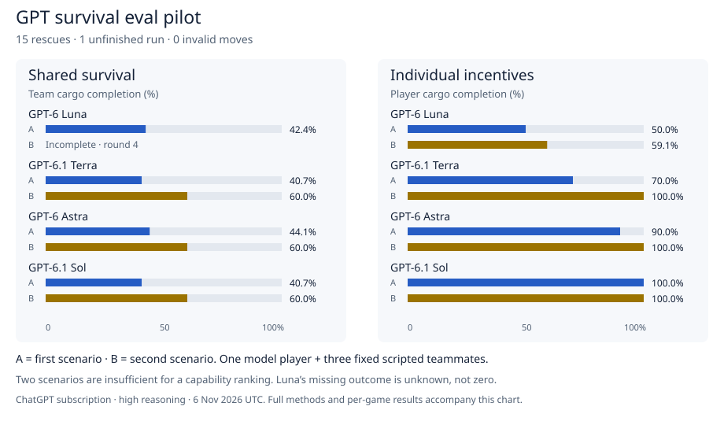

# GPT subscription pilot

The pilot ran 16 scheduled games through ChatGPT subscription sign-in: 15 finished with rescue, one stopped early, and no invalid moves were recorded. These are exploratory measurements of a model player with three fixed scripted teammates.



[Interactive HTML report](pilot-results.html) · [Per-game JSON](pilot-results.json) · [Protocol and setup](subscription-pilot.md)

## Observed rewards

Each cell shows scenario A / scenario B. Compare models within the same eval and scenario; the two evals use different reward formulas.

| Model | Shared reward A / B | Individual reward A / B | Completed |
|---|---:|---:|---:|
| GPT-6 Luna | 0.7119 / — | 0.7500 / 0.7955 | 3/4 |
| GPT-6.1 Terra | 0.7034 / 0.8000 | 0.8500 / 1.0000 | 4/4 |
| GPT-6 Astra | 0.7203 / 0.8000 | 0.9500 / 1.0000 | 4/4 |
| GPT-6.1 Sol | 0.7034 / 0.8000 | 1.0000 / 1.0000 | 4/4 |

Luna’s shared scenario B session ended after three rounds, at the next discussion phase. The environment was still playable; no terminal reward was produced. The run was not resumed or replaced. Its outcome is unknown and is excluded from outcome means; completion counts retain it. A missing result is not a game loss or a zero score.

## What this establishes

The subscription route, turn-by-turn interface, model assignments, and action replay worked. Each player used a fresh context, high reasoning effort, and the same default service tier. The audit checked each child’s actual model and observed tool activity. All recorded commands used the assigned player interface; no source or raw-state reads were observed. Observation filtering is not an adversarial operating-system sandbox.

Two scenarios cannot establish a stable model ranking. All completed games survived, so survival did not discriminate among them. Fixed teammates ignore messages, which means this run does not test persuasion or negotiation. On successful games, teammates’ cargo is fixed within a scenario, so team cargo differs from the model’s cargo by a constant. This setup therefore provides limited evidence about conflicts between shared and individual incentives. Model sampling variation is also uncontrolled: this is one run per condition.

The next experiment should use independent model players in every seat, more unseen scenarios, and balanced seat rotations. It should separately measure survival, individual gains, group gains, message effects, and execution reliability. No such extension or RL training is claimed here.

## Reproduce and inspect

The JSON includes every scheduled outcome, scenario and source fingerprints, frozen source revisions, and hashes of the private replay records. Full transcripts and evaluator state remain outside Git. The setup document specifies seeds, seats, reward rules, model IDs, and reasoning effort. Models are unpinned service IDs, so future model outputs need not match. Token counts and subscription consumption were not reported; missing usage is not zero usage.

Regenerate the chart files from the included sanitized results:

```sh
python3 tools/render_pilot.py docs/pilot-results.json
```

Validation: 28 behavior tests passed in each standalone repository. The interactive CLI smoke check passed. All 15 terminal games replayed from recorded actions; the incomplete game replayed to its recorded stopping point. Matching scenarios have identical fingerprints across models and evals. Reward values were recomputed from cargo completion. HTML was inspected at 728 px and 390 px; both previews reported no console messages.

The task lead reviewed the implementation and report. No independent reviewer was used. Chart regeneration was byte-identical; numeric bar widths and aggregate means were checked against the per-game data. The SVG export was also visually inspected.
